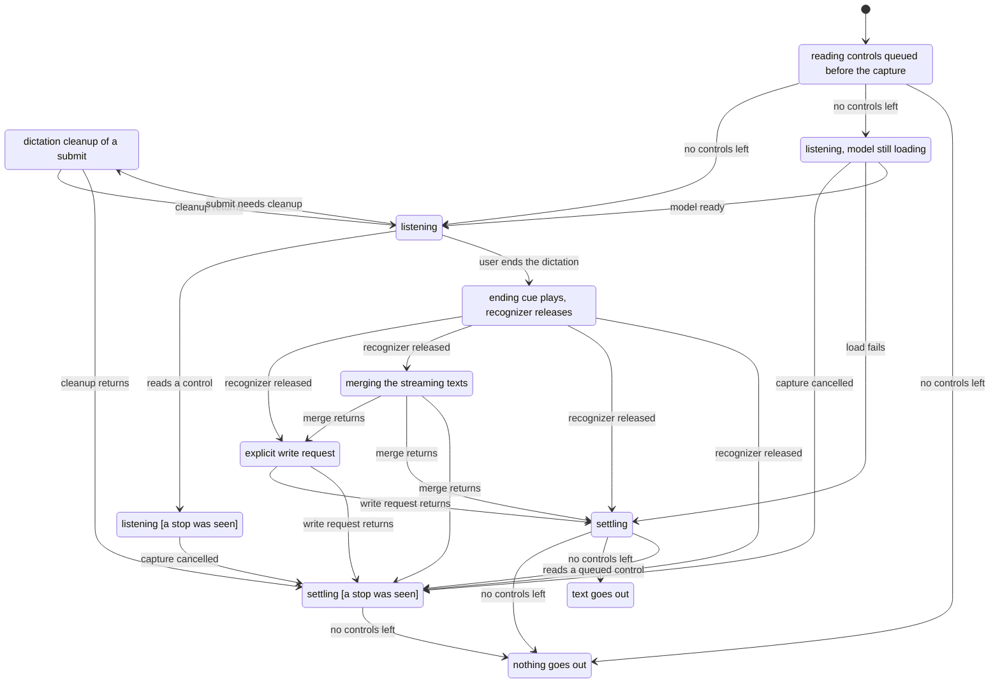

# Formal capture cancellation

## Property

An ending control queued before the capture's final control drain empties must
prevent that capture's accepted result from entering delivery, even if a later
control resumes listening. The CPU replay separately checks that the result's text is kept once, as cancelled.
Breaking this promise can type text, press Enter, or execute a configured task
after the user cancels or pauses.

## Covers

The sync commit and its source hashes are recorded in `source.json`. The notes below say why each covered change since the model was written left its actions unchanged.

Covers: crates/thalvi-app/src/runner.rs crates/thalvi-desktop/src/engine.rs crates/thalvi-desktop/src/engine/streaming.rs crates/thalvi-desktop/src/engine/final_pass.rs crates/thalvi-desktop/src/engine/submit_preview.rs crates/thalvi-desktop/src/recognizer.rs crates/thalvi-desktop/src/delivery.rs crates/thalvi-desktop/src/realtime.rs crates/thalvi-desktop/src/openai_live.rs crates/thalvi-desktop/src/local.rs '.agents/skills/formal-capture-cancel/**'
They include buffered live recognition,
extra recognizer merging and streaming, deferred reload after download, and
waiting for an on-device load. Their mapped actions remain below. Microphone
switching happens after capture; notices, metrics and endpoint payload changes
add no delivery path. `Control::Overlay` (8df760f) returns false from `Requests::ends`, so it never sets `ended` and neither admits nor blocks delivery, the same as `Apply` for this property; it is not one of the modeled controls. No product promise or bound changed in this maintenance.

`Runner::capture` now also tells a capture that failed in the recognizer from one
that failed in delivery (`undelivered`) when it sets the status's failure kind,
after `Settling::settle` has already decided what reaches the host. That is a
label on the status, not a delivery path, so the mapped actions are unchanged.

`Engine::capture` now also records the delivery route on a delivered capture's
metrics line, after `set_state(Listening)` and after the outcome has already
been decided. That write is not a delivery path and adds no cancellation or
queue step, so the mapped actions are unchanged.

The certificate diagnostics change only failure classification in
`recognizer.rs`, `realtime.rs` and `openai_live.rs`. The inspected close, cancel
and loading methods are unchanged: failed connections still deliver nothing,
with no new await or queue step. Model actions remain unchanged.

The experimental Whisper entry (#481) only retypes `Control::ReloadSpeechModel`'s payload, which `Requests::take` still does not count as
an ending, and passes the helper folder into `Chosen::new`; `drive`, `Runner::capture` and `Settling::settle`
are unchanged. Its `WhisperSession` (`crates/thalvi-desktop/src/whisper.rs`) buffers like `OpenAiSession`:
`cancel` and `close` return at once, and dropping a session with its request in flight aborts the request
task and kills the helper, so a late reply has no receiver. Model actions are unchanged. `Live::tail` now waits `RecognizerSession::final_wait()`
after the release of a buffered capture (11 s by default, the helper's request timeout plus a second for
Whisper) instead of a fixed 11 s; running out is the same non-accepted failure, polled after cancellation,
so the model actions are unchanged. Its Vulkan previews (#482) are `RecognizerEvent::Partial`s that
`WhisperSession` returns only before `finish_audio`; the engine's `on_partial` publishes them for display and
never admits one to delivery, the same path the model abstracts for streaming recognizers. The model does not
cover preview ordering inside the session; `whisper.rs` tests do.

The download-size notice (#485) changes only `runner.rs`'s tests module, for
`Step`'s new `Download` payload. No mapped function
changed, and `engine.rs`, `recognizer.rs` and `local.rs` are untouched, so the model actions are unchanged.

The scripted-feed wait fix (#612) changes only `pump_until` in `runner.rs`'s tests module. No mapped
function changed, so the model actions are unchanged.

Retrying a wake model after its download (#616) changes only `runner.rs`'s tests module, for a rig whose
wake head loads once cached. No mapped function changed, so the model actions are unchanged.

Holding unconfirmed lines back from a terminal adds a branch to `Delivery::paste_in` after admission: when the
route is not Submit, the text has a line break and `Host::is_terminal` (a synchronous read of the bound target) says
the window is a terminal, it keeps the text on the clipboard through `keep` instead of calling `deliver`. Both are
host actions after `FinishEmpty`, with no new await, queue step or write to cancellation state, so `delivered`
still abstracts the admission and model actions are unchanged. `runner.rs` changes only in its tests module, for
the new host method.

The app styles change (#464) passes the bound window's app and title into
`Engine::capture` and keeps a local copy for Settings before capture begins.
`Delivery::writing_target` reads the retained target without a platform call.
Prompt selection and its metric are synchronous local values; the writing
request still runs under the same cancellation-biased `bounded` call.
`Requests`, `drive`, `Settling::settle`, the close/cue joins, merge waits and
loading waits are unchanged. No model action, await boundary or bound changes.

A hold released while an on-device model is still loading keeps `Engine::start` reading microphone frames.
Frames after the release cutoff are discarded and are not delivered. The read stays in the same
cancellation-first select: the wait is still unbounded, `Accept` is still enabled only after `Loaded`,
and a cancel still wins. Model actions are unchanged.

`Engine::conclude` no longer merges a Task capture: it takes the existing no-merge branch, calling
`Engine::drop_streams` before `end_with`, the `Accept (merge will not run)` step the model already has.
No await, queue step or delivery path is added, so model actions are unchanged.

The runner-control property (#525) moves desktop loading and
microphone blocking work behind `Rig` and `Input`, with the same awaits and FIFO controls.
`Requests::take`, `Requests::read_queued`, `drive`, `Runner::capture` and `Settling::settle`
keep their bodies unchanged. `follow` now publishes a new engine's initial status; it adds
no cancellation write, await or delivery path. The model actions and bounds are unchanged.

Opt-in dictation cleanup (#465) adds `Engine::clean`, the same cancellation-first `bounded` shape
as `Engine::write`. A submit is cleaned before its confirmation is shown (`Prepare`, then
`CleanupReturns`, then the ending). A paste is cleaned after recognizer release, alongside the ending cue; one `cleaning` stage
stands for both orders, and it is never on together with `writing`. `CleanupReturns` is its own
await: a cancel there yields a cancelled result, so the runner admits nothing. A cleanup that
finishes or falls back returns to the capture, and delivery still meets `FinishEmpty`. The 3 s
bound, including the endpoint becoming ready, is not a cancellation step.

A hold's start cue no longer mutes the microphone: `Engine::begin_hold` leaves the gate open, and
`Engine::start` passes `Mic::Open` to the same wake cue future for a hold (`Mic::Muted` for a wake
word and every other cue), and reopens the gate after the cue only when it was muted. The select in
`Engine::start` is otherwise unchanged: frames are still read only after the cue, from the queue that
kept them, and cancellation still wins. No await, queue step, cancellation write or delivery path is
added, so model actions are unchanged. The replay's `ImmediateCues` takes the new argument.

Accepted ending cues (#574) run in an engine-owned local task while `end_with` awaits
recognizer release under a cancellation-first select. `CueReturns` now changes only
feedback state; `CloseReturns` advances without waiting for it, cancelling the outcome
when a stop was observed before release. The runner's final drain still fences delivery.
A stop after admission may cut the cue short but cannot retract a paste. Cancelled and
error endings retain their joined cue/release path, abstracted as non-accepted outcomes.
The CPU replay runs its capture within a `LocalSet`, as the desktop runner does.

Before returning the next trigger, `Engine::listen` signals cancellation of the
previous ending cue and drains its task. The next `Engine::capture` consumes
that watch version at entry, as before; a hold resumes input after the old
cue has stopped. This await belongs to listening between captures, outside
this single-capture model. It adds no cancellation or delivery boundary to
the mapped capture, so the actions and bounds remain unchanged. Cue-player
construction also warms the paused output in a blocking task; it neither
reads capture controls nor admits delivery.

Interrupted cues retain their first-sample timing for feedback metrics. Reading
that timing neither awaits nor changes capture state. The playback future is
still dropped before input is restored, inside the same ending-cue task; no
model action, delivery guard or bound changes. The replay's immediate player
returns no timing because it produces no audio.

The merge switch (#589) makes the merge optional: with `stt.merge` off,
`Engine::conclude` takes the model's no-merge branch — it tells the streaming
extras the capture ended, asks the upload extras without awaiting them, hands
their tasks to `recorded_only` (`Engine::record_only`) and returns the accepted
live text. `Engine::deliver_with_extras` only chooses between that and the
existing `Engine::merge`. Extras on with the merge off was already reachable in
the model (a scratched capture, or one with no words of its own), and no await,
queue step or cancellation write is added before the final empty receive, so
the model actions and bounds are unchanged. `engine/streaming.rs` changes only
in its comments.

Hold-key recovery (#566) adds `Control::HoldKeyWorks`, which `Requests::take` answers false, like
`Overlay`: it never sets `ended` and neither admits nor blocks delivery. The runner now hands its
pending hold notice into `Requests` before a capture's drains and takes it back after, so a
recovery queued during the capture clears it; that notice is shown only after settling and is not a
delivery path. `drive`, `Runner::capture` and `Settling::settle` are unchanged, so the model actions
are unchanged.

When a finished clip is the only input (#604), `Runner::step` closes the source, restores the
microphone failure and proceeds to the existing wait in the same iteration. This path runs between
captures, outside the single-capture model. `Requests::take`, `Requests::read_queued`, `drive`,
`Runner::capture` and `Settling::settle` keep the same cancellation writes, delivery paths and await
boundaries, so the model actions are unchanged.

The word list on every upload (#624) only adds request data: `OpenAiSession` clones the list's hint
into its existing request task, `Engine::ask_all` and the final pass's task pass the list to
`secondary::transcribe`, and `Engine::ask_merge` passes it to `start_merge` under the same `bounded`
call. No await, queue step, cancellation write or delivery path is added, so the model actions are unchanged.

A selected final pass (#586) keeps streaming extras off. At acceptance it starts one finished-audio
task while the live recognizer closes. Its reply can only supply text through
`Engine::wait_final_pass`, which polls cancellation before both the reply and the deadline. A
cancel during live release aborts the task there. A late answer may reach opt-in text recording
but it cannot re-enter the capture. `FinalReturns` abstracts a reply, fallback or observed cancel;
a skipped request does not need to await it. For submit, optional cleanup and the confirmation
of the settled text follow the final pass, with separate cancellation-first awaits
(`FinalCleanupReturns`, `PreviewReturns`, `ConfirmReturns`). The review interval starts after
the overlay reports a full frame. A refusal, timeout, or lost frame keeps the text for recovery.
An accepted result still crosses `FinishEmpty`.
The model checks delivery admission. It does not check correctness of recognition or a reply's time.

The numbers-as-digits formatter (#588) rewrites text synchronously and adds no
await, control read, queue step or write to cancellation state; a task is never
formatted. An ordinary submit's pending text is formatted before the existing
`Prepare`, cleanup and ending pause, and delivery sends it as shown. A merged
submit whose setting is on is not formatted or cleaned before the merge: after
`SecondaryReturns` its merged text (or the live fallback) is formatted, cleaned
if enabled, then shown whole and confirmed through the existing preview and
review awaits, which the model's `settled` variable selects. A final pass
formats its settled replacement before cleanup and confirmation, as before.
Delivery formats a paste, a write and a settled submit; it never formats an
ordinary submit again. The model checks delivery admission, not whether the
formatted text is right.

The Parakeet ending advice (#450) changes only the text of `CaptureError::NoEnding`: `Engine::new`
reads once whether the live entry is Parakeet, and `idle_error` passes that to the error. The idle
steps in `Engine::drive` and `Engine::feed` still fail the capture with no new await, queue step or
delivery path, so the model actions are unchanged.

A hold that reaches the idle limit (#669) fails with `CaptureError::HeldSilence` instead of
`NoEnding`: `idle_error` takes `Live::is_hold()`, which reads `release`. The idle steps in
`Engine::drive` and `Engine::feed` still fail the capture with no new await, queue step or
delivery path, so the model actions are unchanged.

Keeping recognition running on a base-look change (#659) adds `look` to `retunes_only` in
`runner.rs` beside `themes`. `Requests::take`, `drive`, `Runner::capture`, and `Settling::settle`
are unchanged and `Apply` still has no cancellation effect, so the model actions are unchanged.

Showing Loading through a live recognizer rebuild (#617) shares `Publisher` via `Arc<Mutex<_>>`
between `EngineLink` and `Runner`, tracks rebuild sequence numbers in `Runner::apply`, and sets
`Mode::Starting` at `Runner::rebuild` entry. `Requests::take`, `Requests::read_queued`, `drive`,
`Runner::capture`, `Settling::settle`, and `Runner::apply_engine` keep the same cancellation
writes, await boundaries, and delivery admission fence, so the model actions are unchanged.

Publishing a queued rebuild to the UI and `state` (#677) makes `Publisher::mutate` also update a
separate `rebuilding` watch. No mapped function changed, so the model actions are unchanged.

Cancelling engine builds on quit (#671) adds `Runner::build_interruptible` and `build_session` in
`runner.rs`: `Runner::start` and `Runner::rebuild` select the build against a quit watch that
`EngineLink::quit` sets before it sends `Control::Quit`, and drop the in-flight load. That runs
strictly between captures and leaves the control queue untouched; `Requests::take`,
`Requests::read_queued`, `drive`, `Runner::capture`, and `Settling::settle` are unchanged, so the model actions are unchanged.

Live-recognizer Submit preview confirmation (#675) attaches a `SubmitPreview` to
`EngineState::PendingEnding` for live Submit endings and gates `Step::Quiet` in `Engine::drive`
on `Presentation::Shown` (with a 1 s timeout or failure returning `Done::Failed`). Both new
branches sit below `self.cancel.changed()` in the biased select and can only wait or fail without
admitting delivery, and `Engine::on_quiet` rechecks `Presentation::Shown` before accepting;
`Requests::take`, `drive`, `Runner::capture`, `Settling::settle`, `Delivery`, and
`confirm_final_submit` keep the same cancellation writes and delivery fence, so the model actions
are unchanged.

A release wait the session reports (#449 repair): `RELEASE_LIMIT` is 250 ms again, and
`RecognizerSession::release_limit` gives 400 ms only to a session whose final re-hears the end of
the stretch (Parakeet's TDT decoder, carried from `SpeechModel::release_limit`); `Live::tail`
returns `at + self.session.release_limit()` for a recognizer that does not buffer audio, and the
final pass's `finished` uses the same value. The tail deadline is not a modeled action, await
boundary or delivery guard, and a control queued before the final empty receive still prevents
admission, so the model actions are unchanged.

Finishing a hold whose recognizer is behind (#678): after the release wait, `Step::Tail` in
`Engine::drive` keeps a hold waiting for its final when `RecognizerSession::behind` says audio
from before the release is unanswered, and `Live::tail` then bounds the wait at `FINISH_LIMIT`,
15 s, before the existing non-accepted or accepted end. This is one more awaited poll in the same
cancellation-first select, below `self.cancel.changed()`, so a control seen there ends the capture
with no accepted result, exactly as a cancel before the ending does; `Accept` and
`ActiveCancelled` still abstract the capture's work before the ending, and a control queued before
the final empty receive still prevents admission. Suspending the microphone watchdog during that
wait and the on-device session's backlog count in `local.rs` are neither a cancellation write nor a
delivery path. The model actions are unchanged.

The five checked invariants have these exact meanings:

- `NoDeliveryAfterStop`: a control ending this capture before the final empty
  receive prevents admission to delivery.
- `ExtrasNeverLeftOpen`: at capture completion, extra tasks are no longer owned
  by this capture: cancellation was requested or they were handed to recording.
- `ReleasedWhenCancelled`: an engine-cancelled capture before merge handoff has
  requested cancellation of its extras.
- `LateOnlyAfterMerge`: handing extras to recording without a cancellation
  request happens only after the merge stage completes, including a skipped merge.
- `AcceptedOnlyAfterLoad`: a capture cannot enter its accepted ending, merge or
  writing stage while its recognizer is still loading.

`extra = "released"` means **cancellation requested**, not that a task or socket
has finished closing: `Streams::cancel` notifies tasks and returns their JoinSet,
and `Engine::drop_streams` moves it to `recorded_only`. `extra = "late"` means
that ownership was handed over without that request. `merged` records that
handoff, not successful text merging. Earlier prose claiming no task remained
running or cleanup was bounded by `merge::LIMIT` was unsupported by this model;
the logical invariants are unchanged. Task cleanup and its duration remain
unverified. A runner-only cancel after merge handoff still prevents delivery,
but does not retroactively cancel recorded-only tasks.

All paths below are repository-relative. [source.json](source.json) records
whole-file hashes so a changed implementation cannot silently reuse this model.
Matching hashes establish synchronization only, not correctness of the model.

| Code | Model actions and boundary |
| --- | --- |
| `crates/thalvi-app/src/runner.rs`: `Control`, `Requests::take`, `Requests::read_queued` | `Send`, `DrainOne`, `NextOff`, `Ends`; one channel send or one receive plus runner-local state update. Every receive and drain accumulates ending decisions with OR into `Requests::ended`. `Apply` has no cancellation effect. |
| Same file: `drive` | `PreEmpty`, `Receive`, `FinishEmpty`; pre-start drain, cancellation callback while capture is Pending, and completion drain. Biased polling starts the capture before a later control branch can run. `ended` is never reset inside the call, so a control consumed by `Receive` still counts at `FinishEmpty`. |
| Same file: `Runner::capture`, `Settling::settle` | `FinishEmpty` admits an Accepted result only if `ended` is clear. This is delivery admission at the last empty receive, not an atomic physical host effect. An ended capture skips `Delivery::finish` and is kept as cancelled. |
| `crates/thalvi-desktop/src/engine.rs`: `EngineHandle::cancel`, `Engine::capture` | `cancelPending` represents the watch version change; capture entry consumes the old version. `Accept` and `ActiveCancelled` abstract capture work before the ending. |
| Same file: `Engine::conclude`, `Engine::end_cue`, `Engine::end_with` | `CueReturns`, `CloseReturns`; an accepted cue runs independently and changes feedback state only. Recognizer release polls cancellation first and advances without waiting for the cue. Non-accepted endings still join cue and release and never admit delivery. |
| Same file: `Engine::start`, `download_started`; `recognizer.rs`: `Recognizer::loading`; `local.rs`: `LocalRecognizer::connect`, `loading` | `starting`, `Loaded`, `LoadFailed`; the wait for an on-device model is unbounded and polls cancellation first. `Accept` is enabled only after `Loaded`. A download or load failure is `LoadFailed`, a failed capture that delivers nothing. Frames read during that wait, including after a hold is released, are not a delivery or cancellation step. |
| `engine/final_pass.rs`: `Engine::start_final_pass`, `Engine::wait_final_pass`, `Request::cancel`; `engine.rs`: `Engine::confirm_final_submit`; `engine/submit_preview.rs`: `SubmitPreview::shown`, `SubmitPreview::failed` | `finalMode`, `finalPass`, `finalCleanup`, `preview`, `confirm`. A selected final pass excludes merging and starting the streaming extras. The final task can overlap live release; its response is consumed only through `FinalReturns`. The full text is settled by cleanup and waits for a preview, then for its review interval. A failed preview does not enter delivery. Late recording reaches no delivery. |
| Same file: `Engine::merge`, `Engine::ask_merge`, `Engine::write`, `Engine::clean`, `Engine::prepare_submit`, `bounded` | `secondary` (the merge of the extras' texts), `writing`, `cleaning`, `Prepare`, `SecondaryReturns`, `WritingReturns`, `CleanupReturns`; disabled stages are skipped, awaiting stages poll cancellation first; repeated waits stutter in this abstraction. A synchronous skipped merge returns without another poll; the runner's final drain still guards delivery. Cleanup runs only for a paste or submit with the switch on, and never after an explicit write (`~writing \/ ~cleaning`). A submit's cleanup is `Prepare` before `Accept`, so its confirmation shows the text that will be sent; a paste's is after the ending, and one stage stands for both. A cancel during it returns a cancelled outcome, so nothing is pasted. |
| `crates/thalvi-desktop/src/engine/streaming.rs`: `Streams::start`, `Streams::finish`, `Streams::cancel`, `send_frame`, `hear`, `park`, `run`; `engine.rs`: `Engine::drop_streams` | `extras`, `extra`, `merged`: `PreEmpty` opens the extra sessions, `Accept` (merge will not run), `ActiveCancelled`, `CloseReturns` (ending cancelled) and `SecondaryReturns` (cancel) request their cancellation, an uncancelled `SecondaryReturns` leaves them `late`. The model tracks ownership and notification only; the task awaits `RecognizerSession::cancel` or `close` separately. |
| `crates/thalvi-desktop/src/recognizer.rs`: `RecognizerSession`; `crates/thalvi-desktop/src/realtime.rs`: `RealtimeSession::close`; `crates/thalvi-desktop/src/openai_live.rs`: `OpenAiSession::cancel`, `OpenAiSession::close` | `CloseReturns` may occur before or after the independent accepted cue. Network close is awaited under a timeout, so it can remain Pending; `OpenAiSession::close` aborts its upload task and returns at once. |
| `crates/thalvi-desktop/src/delivery.rs`: `Delivery::finish`, `paste_in`, `call` | `delivered` abstracts admission to a valid configured host action. Actual host execution is outside the proof; once admitted it can run via `spawn_blocking`. Other changes to this file are not covered by the model. |

## Run

TLA+ with TLC explores all interleavings in the stated finite model; it fits
this ordering property but does not execute the production implementation.

From the repository root, with Python 3.12+:

```sh
.agents/skills/formal-capture-cancel/scripts/check.py
```

The command installs TLC's stable `v1.7.4` release artifact (TLC2 Version 2.19 of 08 August 2024) into
`${XDG_CACHE_HOME:-~/.cache}/thalvi-formal/` and verifies SHA-256
`936a262061c914694dfd669a543be24573c45d5aa0ff20a8b96b23d01e050e88`.
It is a published release whose file does not change. The `v1.8.0` pre-release
is re-uploaded upstream, which broke the old checksum on 2026-11-06.
[Upstream tool and download instructions](https://github.com/tlaplus/tlaplus).

Use an existing `java` (11+). On Linux x86-64 without Java, the command installs
Temurin JRE `21.0.9+10` in the same user cache, verifying archive SHA-256
`aeab55d064a1a27a3744b0880b9b414077b4ed2b1790817eea3df60aec946431`.
Other platforms need a user-installed Java on PATH. No system package install
is performed. Downloads require network access only on the first run.

A faithful run here explores 242,147 distinct states (751,104 generated) with no
error; a warm full check takes about 2 s, and the self-test about 10 s. The extra
states are the dictation-cleanup stage and the settled merged submit's cleanup,
preview and confirmation. Each TLC invocation has a 120 s limit and 512 MB heap limit.
State counts are receipts for this model, not acceptance criteria for a changed model.

A passing run deletes its `/var/tmp/thalvi-formal-...` folder. A counterexample, a
run blocked once the folder exists (not source drift), and `--self-test` keep it and print `EVIDENCE=/var/tmp/thalvi-formal-...`
(TLC output, trace, copied model/config and generated states). Exit 0 prints `PASS`;
exit 1 prints `COUNTEREXAMPLE` and `FAIL`; exit 2 prints `BLOCKED` for source
drift, a tool error, or timeout. The current faithful result is exit 0.
Never turn a failure into a success verdict.

Check the negative controls after changing the verification:

```sh
.agents/skills/formal-capture-cancel/scripts/check.py --self-test
```

This runs the full faithful model, then each control with its named invariant
alone, so another violation cannot hide a missing detector:

| Control | Broken code behavior represented | Must fail |
| --- | --- | --- |
| `DropCompletionGuard` | `Settling::settle` admits an ended capture | `NoDeliveryAfterStop` |
| `ForgetEarlierStop` | `Requests::take` overwrites `self.ended` instead of OR-ing | `NoDeliveryAfterStop` |
| `LeakExtraOnCancel` | cancellation paths hand off extras without notifying them | `ExtrasNeverLeftOpen` and, separately, `ReleasedWhenCancelled` |
| `late-without-merge` | `drop_streams` hands extras off as recording-only without cancellation | `LateOnlyAfterMerge` |
| `accept-before-load` | `Engine::start` permits an accepted ending before connect completes | `AcceptedOnlyAfterLoad` |

The last two controls edit a copy of the model and require an exact match;
no working-tree source is changed. `SELF-TEST PASS` means the faithful model
passed and all six controls broke exactly their named invariant. It is not
physical desktop verification. The production config remains `Scenario = "all"`,
all mutation constants FALSE, `MaxControls = 3`.

For a deterministic CPU replay against the real engine and delivery, plus
byte-for-byte extracted `Control`, `Requests`, and `drive` from the current
runner:

```sh
.agents/skills/formal-capture-cancel/scripts/repro.py
```

This copies tracked Rust sources to a new `/var/tmp/thalvi-cancel-repro-...`
directory, runs the workspace's pinned Rust toolchain and locked Cargo
dependencies offline, and builds only the desktop library test in a dedicated
user-cache target directory. It needs cached Cargo dependencies and native
build prerequisites from AGENTS.md. It uses immediate fake cues, an event-gated
fake recognizer close and a recording host; no audio, native host, model, or
service is used. The runner's `Control`, `Settling`, `while_delivering`,
`Requests` and `drive` are extracted byte for byte, so the replay settles the
real engine's outcome through the real admission code.
A finding prints `FINDING` and exits 1; a resolved replay exits 0; a compile,
setup, or 300 s timeout failure exits 2. Raw evidence stays outside Git.
Before the fix the replay failed with `CANCEL_REACHED_DELIVERY`, Accepted
output and `delivered=true`. Now it observes Accepted output with `ended=true`,
no host call, and one cancelled history entry and draft carrying the text.
The second replay gates the same shutdown without Cancel, presses and releases
the hold key while close is pending, and checks one refusal and successful delivery.
The settings replay extracts `Runner::apply_engine` and `refuse_unheard` byte for byte,
gates a fake rebuild, and checks one refusal for a tap or held press just before
Apply or during the rebuild, through both
success and failure. It also replays identical and retune-only Apply handoffs with the real engine,
accepting a held press or reporting a completed tap. It checks engine retune/rebuild handoffs, not the outer `Runner::apply` microphone
switch, model loading or native input. A warm replay takes about 5 s.
The replay respects an existing `TMPDIR` and `CARGO_TARGET_DIR` for managed jobs.

### Chart

A review aid, separate from the check:

```sh
.agents/skills/formal-capture-cancel/scripts/check.py chart
```

It runs the same pinned TLC on the faithful model under `TypeOK` alone, in `/var/tmp`, and
redraws [chart.mmd](chart.mmd) from [view.py](view.py) with `scripts/chart.py` (about 6 s;
it prints `CHART written states=<n> arrows=<n>`). A `CHART skipped` line or a chart error never
changes the check's result. When the model changes, update `view.py` with it (every action
must be in `ACTIONS`), then rerun `chart`.

Compare the chart with what the product should do before reading TLA+.



## Read a result

A pass holds only for the bounds and assumptions below. For a failure, open
the printed `tlc.txt`; replay each named action against the mapped function.
An impossible step is a modeling error: correct it from the code and explain
what was wrong. If every step is possible, report the bug and its harm.

Shortest trace of the fixed bug (secondary disabled), kept to read the model:

1. `runner.rs::drive` finishes its empty pre-start drain (`PreEmpty`).
2. `EngineLink::send` queues Cancel (`Send`); capture polling can win before the runner receives it.
3. `engine.rs::conclude` reaches Accepted and starts `end_with` (`Accept`).
4. `engine.rs::end_cue` finishes successfully while recognizer close remains Pending (`CueReturns`).
5. `runner.rs::drive` receives Cancel, `Requests::take` returns true, and `EngineHandle::cancel` changes the watch version (`Receive`).
6. `realtime.rs::RealtimeSession::close` completes or times out; `engine.rs::end_with` returns the cue's earlier true, and disabled `merge` returns Accepted (`CloseReturns`).
7. `runner.rs::drive` finds an empty completion queue because it consumed Cancel already; `Runner::capture` admits Accepted to `Delivery::finish` (`FinishEmpty`).

Cancel enqueued after step 4 reached the same bug; the CPU replay uses that
order. Step 7 now finds `ended` set by step 5 and admits nothing.

## When the covered code changes

1. Read the diff and commit messages since the sync commit for every covered
   file, following moved functions and new writes to cancellation or delivery
   state. Read the functions even if a hash change looks cosmetic.
2. Update actions from the code **before** running TLC. Preserve separate await
   boundaries and queue iterations. Do not model `end_with` as one indivisible
   operation. Do not assume that invoking the cancellation callback guarantees
   a cancelled outcome.
3. Change the property only if the product promise deliberately changed, with
   evidence from a decision, contract, test or commit. Preserve bounds; report
   any necessary reduction. Never tune the model to hide a counterexample.
4. Update each affected SHA-256 in `source.json` from the inspected working
   file (`sha256sum <path>`), and move `sync_commit` to the inspected commit
   only after confirming the model describes it. During an uncommitted change,
   keep the prior commit; the next maintenance pass reads from it. Do not write which commit a hash describes; `source.json` is that record. If the sync
   commit is missing from history (a rebase), read from the last commit that changed `source.json`.
   Hash updates are not a substitute for step 2.
5. Run the full check and negative controls. Replay any new counterexample;
   preserve a real failure. The known failure may be resolved only with code
   evidence and a faithful full-model pass, plus the real-code replay.

To prove the recipe in a throwaway worktree, change `Requests::take` in
`crates/thalvi-app/src/runner.rs` from `self.ended |= ends;` to
`self.ended = ends;`. The check must first report `SOURCE DRIFT`. Read that
diff, set `ForgetEarlierStop = TRUE` in the scratch config and refresh the
source hash; the full check must report `COUNTEREXAMPLE NoDeliveryAfterStop`.
The local `read_queued` accumulator still ORs its decisions; mutating only that
local accumulator no longer reproduces the fixed delivery bug. Remove the
scratch worktree and rerun the faithful check. Product files in the working
checkout must be unchanged.

## Scope

One capture, initially listening, one logical FIFO producer (representing
channel send order), and zero to three controls from Cancel, pause, resume,
toggle, Apply, an update's restart request (never ending a capture: the engine answers busy) and Quit. Every combination of enabled and disabled/skipped
second-pass transcription and writing, with or without streaming extras, is explored. Each queue send, each receive, and each modeled awaited
completion is a separate transition; repeated capture and merge awaits are abstracted as stuttering; synchronous runner-local updates are
combined where no other actor reads them. The final empty receive is the
admission fence. Sends after that fence belong to the next flow and are not
covered; native delivery need not already have occurred at the fence.

The pre-accept capture pipeline is abstracted as an accepted result or an
observed cancellation; a failure and "never mind" are the same non-accepted end. Each extra session's
own connect, frames, events and text are not modeled, only whether the capture owns their tasks or has handed them off with or without a cancellation request.
The replay has no streaming extra and runs with dictation cleanup off. Recognition and silence correctness, watch wraparound,
channel disconnection, thread/process failure, repeated captures, more than
three controls, liveness/fair scheduling, config application, history writes,
real sockets/audio/cue devices, OS focus, clipboard, key injection and native
platform behavior are not verified. `Apply` stands for any settings payload
because payload content does not change `Requests::take`'s ending decision.
The Rust replay covers two concrete shutdown orderings, not these exclusions.
