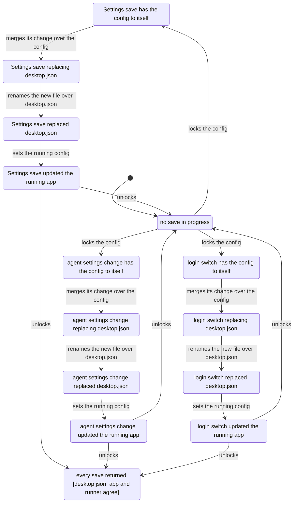

# Formal config save

## Property

Every save leaves `desktop.json` a whole config. Once all saves have returned,
the running app and the file hold the same settings, and each setting holds the
value of the last save that reported success for it.
Breaking this can leave a config the next start cannot load. It can also
silently run other settings than the file, undo a switch or a Settings change
the user was told was saved, or keep a change the user was told had failed.

Three invariants, each one sentence:

- `FileAlwaysWhole`: `desktop.json` always names a fully written config
  (`Store::save`: "replaces the file in one step").
- `RunningMatchesFile`: once every save has returned, `AppState::config`, the
  engine's last `Control::Apply` and the file agree.
- `EachFieldKeepsItsLastSave`: once every save has returned, each form setting
  is that of the last form save that set it and returned Ok (a save that sets
  one setting never undoes another's), and the switch is that of the last
  switch save that returned Ok. A Save never writes the
  switch, and a switch never writes the form (DECISIONS.md, "Packaged desktop
  with an OS-held login entry": the preference is "written by the switch alone,
  never by Save").

**Current result: PASS.** `SyncedConfig` in `app.rs` holds one lock from
reading the config through `Store::save` and `AppState::apply` (for a switch,
through setting the running config), so the writers cannot interleave and
share the one temporary name safely. An agent change reads the config, merges
its patch over it and validates it inside that lock (`settings_set` hands
`plan_over` to `SyncedConfig::save_form`), so it rebases on a Settings save
that finished first. The traces below are the runner's output from before the
fix, in the code's words.

`FileAlwaysWhole`, a Settings save and an agent change at once:

1. Both read `AppState::config` (`commands::save` → `state.config()`).
2. The Settings save's `write_private` removes `desktop.json.tmp`, creates it and writes it.
3. The agent's `write_private` removes that name (unlinking the Settings file) and creates its own, still empty.
4. The Settings save's `write_atomically` renames `desktop.json.tmp`, which is now the agent's empty file, onto `desktop.json`, and returns Ok.

Until the agent's `write_all` lands in that same file, `desktop.json` is empty.
If the app is killed then, the next start cannot load its config.

`RunningMatchesFile` and `EachFieldKeepsItsLastSave`, with a login switch
flipped by an agent request at the same time:

1. The Settings save, the agent change and `AppState::remember` each read the config.
2. All three remove `desktop.json.tmp`; the switch creates it.
3. The Settings save's `create_new` fails because the name exists. Its error path removes the name, the switch's file, and Settings shows that the save failed.
4. The agent creates its file and writes its settings; the switch writes into its own file, which is no longer linked.
5. The switch renames, moving the agent's file onto `desktop.json`, and stores its config in memory: Ok.
6. The agent's rename finds no `desktop.json.tmp` and returns an error, so the agent is told the change was refused.

Now the file holds the agent's refused change with the switch off, and the app
runs the old settings with the switch on. The next start silently loads
settings the agent was told were refused, and it forgets the switch the user
turned on.

An agent change that planned outside the lock lost a Settings save
(`AgentMergeOutsideLock` below, and the Rust test
`an_agent_change_keeps_a_settings_save_that_finished_while_it_was_planned`):

1. The agent's `settings_set` calls `plan`, which reads the config (look `gunmetal`) and merges `{"microphone": "USB Mic"}` into a whole form.
2. A Settings save sets the look to `holo` and returns Ok.
3. The agent's `save` takes the lock and writes its whole form, look `gunmetal` again, and returns Ok.

Both were told they saved; the file and the running app lost the new look.

A plain stale read breaks `EachFieldKeepsItsLastSave` too, without the shared
temporary name. `remember` reads the config, a Settings save completes, and then
`remember` writes the old form back with the new switch. The `SnapshotOutsideLock`
control below shows that trace.

Each overlap needs two saves within the few file-system calls of
`write_atomically`, a window of microseconds to milliseconds. An agent that
sends two settings requests at once reaches it without the user, because
`channel.rs` and `pipe.rs` answer each request on its own thread.

## Covers

Sync commit: `7e5f31deed648c159bfed41245116d06b5711fbb`. [source.json](source.json)
records whole-file hashes, so a changed file cannot silently reuse this model.
Matching hashes establish synchronization only, not correctness of the model.
The notes below say why each covered change since the model was written added no writer.

Covers: crates/thalvi-app/src/settings.rs crates/thalvi-desktop/src/private.rs crates/thalvi-app/src/commands.rs crates/thalvi-app/src/app.rs crates/thalvi-app/src/agent.rs crates/thalvi-desktop/src/host/channel.rs crates/thalvi-desktop/src/host/windows/pipe.rs '.agents/skills/formal-config-save/**'

The app styles change (#464) registers
two read-only Settings commands in `start` (the current app and why app styles
may not apply) and adds agent tests for `writing.apps`; `writing.apps` is
checked by the same config load as every other field. None of it writes
`desktop.json` or `AppState::config`, or takes the save lock. The model and its
three invariants are unchanged. Main's word-list report (`e1981db`) adds one test field in `agent.rs`, and its
download failure report (#493), which changes what `download_speech_model`
returns in `commands.rs` and `app.rs`; neither adds a writer.

`app.rs`'s `run` now returns from `Launch::Watch` before setup, so a terminal
view never opens the app, writes `desktop.json`, or takes the save lock.
`agent.rs`'s `metrics_summary` reads the metrics log and writes no config.
Neither is a writer of the file or of `AppState::config`.

`themes` is one more form field. `Store::check` and `judge` both restore an unchanged look and
refuse a changed look this build cannot use, still inside the save lock for a
save and before `write_atomically`. `settings check` calls `judge` and writes
nothing. A whole-file or per-look `null` removes that key through the existing
merge patch. `AppState::use_built_in_look` sets the active look's `suspended`
flag through `SyncedConfig::remember`, the same lock as the login switch. The
tray item and an agent `settings set` of that flag are callers of those writers.
No new writer, lock, or temporary name is added. A `themes` value this build
keeps whole is written back by the same restore step when the save does not
change it.

An unreadable look, and a built-in-look save that fails, are recorded on `LastError` for the tray and Settings. Neither writes `desktop.json` or takes the save lock.

The numbers-as-digits setting (#588) shapes the form in `settings_json` and narrows the writing
key restore in `unmask_keys`: a writing object with no endpoint keeps no key. Saves still go
through `Store::check`/`Store::save` and `settings_set`'s existing lock and temporary name; no
new writer, lock or temporary file is added, and the model and its three invariants are
unchanged.

The opt-in dictation cleanup (#465) adds one agent test in `agent.rs`. `settings_set` is unchanged: the new field is refused by the same config load as every other writing field. No writer of `desktop.json` or `AppState::config` is added, so the model and its three invariants are unchanged.

The experimental Whisper entry (#481) adds no writer:
`commands.rs` lists the Whisper models, words their device line and downloads their files into the model
store, `app.rs` passes the packaged helper folder into `AppState::start`, and `agent.rs` names the model in
`recognizer`. None writes `desktop.json` or `AppState::config` or takes the save lock.

`AppState::apply` in `app.rs` also sends the overlay the recordings choice and the Show the
overlay setting (#619), on the channel it uses for the look, and `start_overlay` keeps the recorder
that choice switches and sends the setting at start. None of it writes `desktop.json` or
`AppState::config` or takes the save lock, so the model and its three invariants are unchanged.

Hold-key recovery (#566) changes only `held` in `app.rs`: a desktop that refuses the keys at start
keeps a watch that binds them at a later config reload, and a refused key change in Settings still
ends the save before `Create`, as before. No writer of `desktop.json` or `AppState::config` and no
lock is added, so the model and its three invariants are unchanged.

The final-pass switch (#586) uses the existing Settings patch and validation path. The agent reports
the final pass as a cancellable capture state, so a config saved while it waits is applied at the
same boundary as other changes during capture. No writer, lock or temporary file changes.

The merge switch (#589) adds `stt.merge` and reads it in `check_endpoint_kept`: removing the writing
endpoint is refused only while an extra is on and the merge is on, and a form without the switch reads
it as `any_extra`, as the loader does. That is the refusal `Store::check` already returns before
`write_atomically`, under the save lock. `agent.rs` changes only in its tests module. No writer, lock
or temporary file changes, so the model and its three invariants are unchanged.

The shared private-file module (#528) moves `settings.rs`'s `write_private` and the rename into
`thalvi_desktop::private::write_atomically`, which history also uses for its own file. The steps,
their order, the shared `desktop.json.tmp` name and the cleanup on error are unchanged, and
`settings.rs` still creates the folder first; `app.rs` only drops a `cfg` before `prepare_toolkit`.
No writer, lock or temporary file changes, so the model and its three invariants are unchanged.

The look preview (#518) adds the read-only `preview_overlay` command in `commands.rs` and, in
`app.rs`, an `AppState` flag holding the system theme for it, set where the overlay is told the theme.
Neither writes `desktop.json` or `AppState::config` or takes the save lock, so the model and its three
invariants are unchanged.

| Code | Model action and boundary |
| --- | --- |
| `crates/thalvi-app/src/commands.rs`: `save` (from `save_settings`, the Settings window), `settings_patch` | Writer `S` on the main thread, one at a time with other main-thread writers. Via `AppState::save_form` into `SyncedConfig::save_form`: `Lock` before `Snap`, `Unlock` after `Send`. `Snap`: `settings_patch` merges the window's patch (only what the user changed) over the config read under the lock, with `settings::merged`, which `plan_over` uses too; the Settings save sets its field (the look) and carries the others over. This abstracts any one Settings form field, including `update_channel`; that setting has no separate writer. `Store::write` runs through `AppState::take_effect`'s `write`, after any changed hold keys are watched; a desktop that refuses them ends the save before `Create`, like any refused save. |
| `crates/thalvi-app/src/agent.rs`: `settings_set`, `plan_over`, via `Live::save` in `app.rs` | Writer `A` on a request thread; the same `commands::save` path. `Snap` is `plan_over` on the config `SyncedConfig::save_form` read under the lock: the patch merged over the whole form, so it sets its own field (the microphone) and carries the others over. `settings check` (`plan`) writes nothing and is not modeled. |
| `crates/thalvi-app/src/app.rs`: `SyncedConfig::remember` (from `AppState::remember`, reached by `remember_login`, `remember_menu_entry` and `Live::set_switch`) | Writer `L` on a request thread. `Lock` before `Snap`: reads the whole config and sets the switch under the lock; `Store::save_switches` writes it; the running config is set before `Unlock`. |
| `crates/thalvi-app/src/settings.rs`: `Store::check` (form saves), `Store::save` (switches), `prepare` | The content each writer validates: a form save keeps `current`'s switches; a switch keeps the form it read. |
| `crates/thalvi-desktop/src/private.rs`: `write_new` (from `write_atomically`, which `settings.rs`'s `write_atomically` calls after creating the folder) | `RmTmp` (`remove_file` of the shared name), `Create` (`create_new`; fails if the name exists), `Write` (`write_all` into the opened file). Under the save lock these steps cannot interleave with another writer's. |
| Same file: `write_atomically` | `Rename` (moves whatever `desktop.json.tmp` names now; fails if it names nothing). On any error it removes the shared name and returns Err. |
| `crates/thalvi-app/src/app.rs`: `AppState::apply` | `Apply`: `SyncedConfig::set` updates `current` under its mutex while the separate save lock remains held. `Send`: `Control::Apply` to the runner, which takes them in order. |
| `crates/thalvi-app/src/app.rs`: `SyncedConfig::wake_head_downloaded` (from `AppState::wake_head_downloaded`, which `commands::download_wake` calls after a wake download, #616) | Not a writer: under the save lock it reads `current` and, when it selects the downloaded head, sends it as `Control::Apply`. That is the `Send` of a save that changed nothing; it writes neither the file nor `current`, and what it sends is what both already hold, so it cannot reorder behind a save. |
| `crates/thalvi-app/src/settings.rs`: `Store::start` (from `AppState::start` in `app.rs`'s `setup`) | Not modeled: a first start writes the defaults, and a load that drops a saved Thalvi server entry writes the normalized config, both through `Store::write` before `setup` registers the state, serves requests or opens Settings, so no other writer exists yet. |
| `crates/thalvi-app/src/update.rs`: `Marker::write` and update-channel reads | Not a config writer: the updater's atomic write targets the separate `update.json` marker. The channel is read from `AppState::config`; changing it is covered by the Settings form writer above. |
| `crates/thalvi-desktop/src/host/channel.rs`: `accept`; `windows/pipe.rs`: `accept`, `answer` | Why `A` and `L` run concurrently: one `thalvi-request` thread per connection, up to `MAX_CONNECTIONS`. |

## Run

TLA+ with TLC explores all interleavings in the stated finite model; it fits
this ordering property but does not execute the production implementation.

From the repository root, with Python 3.12+:

```sh
.agents/skills/formal-config-save/scripts/check.py
```

The command installs TLC's stable `v1.7.4` release artifact (TLC2 Version 2.19
of 08 August 2024) into `${XDG_CACHE_HOME:-~/.cache}/thalvi-formal/` and verifies
SHA-256 `936a262061c914694dfd669a543be24573c45d5aa0ff20a8b96b23d01e050e88`, the
same pin as `formal-capture-cancel` ([upstream](https://github.com/tlaplus/tlaplus)).
It uses an existing `java` (11+); on Linux x86-64 without one it installs Temurin
JRE `21.0.9+10` in the same cache, verifying SHA-256
`aeab55d064a1a27a3744b0880b9b414077b4ed2b1790817eea3df60aec946431`. Nothing is
installed system-wide, and the network is needed on the first run only.

It checks each invariant in its own TLC run, so every broken one gets its own
shortest counterexample. That takes about 2.5 s warm, and each run has a 120 s
limit and a 512 MB heap. It prints `EVIDENCE=/var/tmp/thalvi-formal-config-...`
and keeps TLC's output there, outside the checkout. Each counterexample prints
as numbered steps naming the writer (Settings save, agent settings change, login
switch) and the action from the table. Exit 0 prints `PASS`; exit 1 prints
`COUNTEREXAMPLE <invariant>` for each broken one, then `FAIL`; exit 2 prints
`BLOCKED` for source drift, a tool error or a timeout. The current result is exit 0; the traces above are historical fixed bugs. Never turn a failure into a pass.

After changing the verification, check that the invariants can pass and fail:

```sh
.agents/skills/formal-config-save/scripts/check.py --self-test
```

It first runs `Serialized = TRUE`, one lock held from before `Snap` until
after `Send`, which must pass every invariant (131 distinct states). This is the current implementation, not a proposed fix. Then
five mutations of that design each must break their own invariant:

| Mutation constant | What it breaks in the serialized design | Must break |
| --- | --- | --- |
| `SnapshotOutsideLock` | the config is read before taking the lock | `EachFieldKeepsItsLastSave` |
| `ApplyOutsideLock` | the lock is released before `AppState::apply` | `RunningMatchesFile` |
| `AgentMergeOutsideLock` | the agent reads and merges its patch before taking the lock, as `plan` did before the repair | `EachFieldKeepsItsLastSave` |
| `SettingsMergeOutsideLock` | the Settings save builds its form before taking the lock, as the window did when it sent the whole form it had last read | `EachFieldKeepsItsLastSave` |
| `RenameBeforeWrite` | the temporary file is renamed before it is written | `FileAlwaysWhole` |

`SELF-TEST PASS` verifies detection only; it is not a pass of the code as it is.

### Chart

A review aid, separate from the check:

```sh
.agents/skills/formal-config-save/scripts/check.py chart
```

It runs the same pinned TLC on the faithful model under `TypeOK` alone, in `/var/tmp`, and
redraws [chart.mmd](chart.mmd) from [view.py](view.py) with `scripts/chart.py` (about 1 s;
it prints `CHART written states=<n> arrows=<n>`). A `CHART skipped` line or a chart error never
changes the check's result. When the model changes, update `view.py` with it (every action
must be in `ACTIONS`), then rerun `chart`.

Compare the chart with what the product should do before reading TLA+.



## Read a result

A pass holds only for the bounds and assumptions under Scope. For a failure,
replay each numbered step against the function the table maps its action to.
A step the code cannot take is a modeling error: fix the model from the code
and say what was wrong. If every step is possible, it is a bug: report the
steps in the code's words, with the harm. The traces above describe the fixed bugs, not the faithful current output.

## When the covered code changes

1. Read the diff and the commit messages since the sync commit for every covered
   file. Follow new writers of the config file or of `AppState::config`, and any
   lock or queue added around them. A shared atomic-write helper does not make a
   writer of another file a config writer; check the target path.
2. Update the model from the code **before** running TLC. A fix that serializes
   the writers changes the faithful configuration, for example by setting
   `Serialized = TRUE` if one lock spans the read, the file write and the apply.
   Model it as the code does it, not as the `Serialized` flag happens to.
   Keep each file-system call and each lock its own step.
3. Change an invariant only if the promise changed on purpose, with evidence (a
   doc comment, test, DECISIONS.md entry or commit message), and record the old
   wording, the new wording and that evidence here.
4. Update each changed file's SHA-256 in `source.json` (`sha256sum <path>`), and
   move `sync_commit` only after confirming that the model describes that commit.
   For an uncommitted change, keep the previous commit; the next maintenance pass
   reads from it. Do not write which commit a hash describes; `source.json` is that record. If the sync
   commit is missing from history (a rebase), read from the last commit that changed `source.json`.
5. Run the check and `--self-test`. When a fix lands, the faithful run must pass;
   update the finding above and keep a mutation that reverts the fix.

To prove the recipe in a throwaway worktree, in `SyncedConfig::remember`
(`crates/thalvi-app/src/app.rs`) move `let mut config = self.config();` before
acquiring `self.lock`. The unchanged check must first report `SOURCE DRIFT`.
Read the diff: only writer `L` now snapshots before locking, so add
`\/ (o = "L")` to `ReadsBeforeLock(o)` in the scratch `ConfigSave.tla` and
refresh the source hash. The check must fail `EachFieldKeepsItsLastSave`.
Restore the scratch files and confirm the faithful check passes. Removing the
temporary-file cleanup alone is not a failing recipe with serialized writers.

## Scope

Three writers that each save once: a Settings save on the main thread, and an
agent settings change and a switch flip on request threads. Every interleaving
of their file-system calls and locks. Content is abstract: a form of two fields, the look
that the Settings save sets and the microphone that the agent sets, each save
carrying the other field over from the config it read, and one switch.

Assumed: each file-system call is atomic, and `write_all` of a config this size
lands in one step, so a half-written file is not modeled; validation in `load`
never fails; the runner applies `Control::Apply` messages in send order;
`rename` replaces the target atomically.

The Settings window and agent send patches merged over `current` under the
save lock. The model checks two distinct scalar fields and one switch; arrays
such as `stt.entries` are replaced whole, and patch construction in the UI is
outside the proof. `engine` is the last configuration **enqueued** by
`Control::Apply`, not an observation that the engine has already rebuilt or
switched microphones. `d6385653` explicitly distinguishes changes that apply
now from those deferred until the next capture. The in-memory configuration
is `SyncedConfig::current`; device adoption is not this invariant's claim.

Not verified: two writers on the main thread at once (they cannot overlap); a
tray switch on the main thread racing an agent save (the same steps as `L`,
with `MainThread = {"S", "L"}`); more than three writers; partial writes, disk
full and crashes beyond the empty-file state; the Settings form's own stale
state beyond the patch it sends (`settings.ts`); a list such as `stt.entries` is replaced whole by a patch that changes it; the OS login entry that
`startup::set` changes before `remember`; Windows file-sharing errors on
`rename`.
